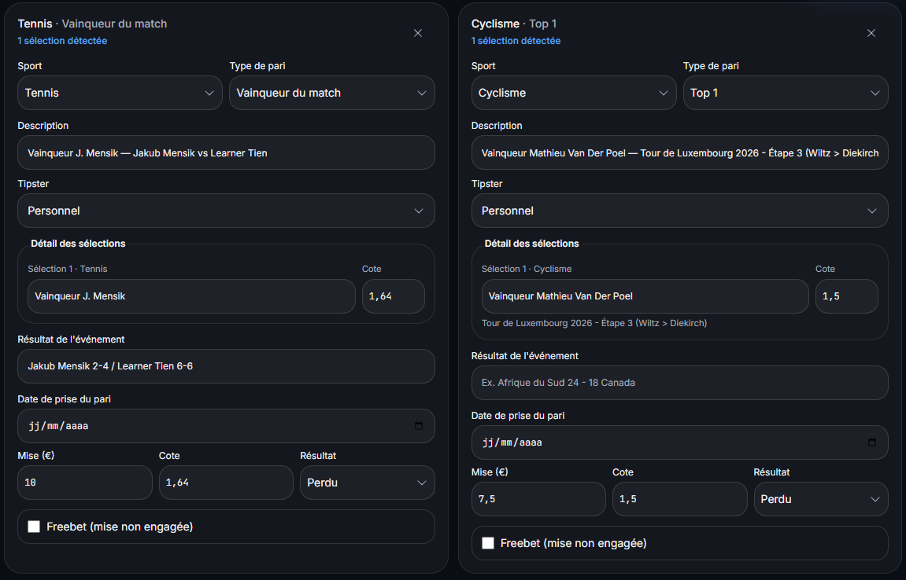

# How can you compare betting results by sport without drawing conclusions too quickly?

> Brouillon préparé le 2 novembre 2026 — non publié. Ciblage à qualifier ; aucune date de publication définie.

Use a common period and consistent accounting rules, then read settled slip counts, total stakes and net profit together. A smaller loss in cash does not establish that one sport suits you better: you may simply have staked less on it.

## Choose the question before sorting the table

A breakdown can show where you staked the most, where you lost the most cash, or how the result compares with the amount staked. Those are different questions, even when they use the same slips.

An absolute-loss ranking describes the amounts lost. On its own, it does not measure differences in skill between sports.

## Build comparable groups

Choose a common period and scope: bankroll, any bookmaker filter, currency, bet type and settlement status. Use settled slips for this example; open bets do not yet have a final result.

Keep freebets, refunds and cash outs separate until their accounting rules are explicit. Stakes and returns must mean the same thing in each group.

Check how mixed-sport accumulators are grouped. One accumulator has a shared stake: copying that entire stake into every sport inflates the totals. Use a separate category or another documented convention, and reconcile the group totals with the history.

## A real example: one tennis slip and one cycling slip

Screenshots supplied by Jeremy on September 25, 2026 document two singles dated September 18. The tennis stake is €10 and the cycling stake is €7.50. Both lost with zero return; the matching history entries show −€10 and −€7.50.

The table covers only these two slips. It does not represent Jeremy’s complete bankroll or his usual performance in either sport.

| Measure | Tennis | Cycling | Example total |
| --- | --- | --- | --- |
| Settled slips | 1 | 1 | 2 |
| Total stakes | €10.00 | €7.50 | €17.50 |
| Returns received | €0.00 | €0.00 | €0.00 |
| Net result | −€10.00 | −€7.50 | −€17.50 |
| Result relative to stakes | −100% | −100% | −100% |

## Why cycling is not the better-performing sport in this example

The cash loss on cycling is €2.50 smaller, but the stake was also €2.50 smaller. Both groups returned nothing and lost their entire stakes, so their results relative to stakes are identical.

“I lost less cash on cycling” describes this extract. “I perform better on cycling” adds a conclusion that the extract does not establish. Each group contains just one slip.

The calculations are −10 ÷ 10 = −1 and −7.50 ÷ 7.50 = −1: −100% in both cases. The ROI article explains the formula and how it differs from win rate.

## Keep slip counts and stakes next to percentages

Show the number of slips alongside each percentage. Otherwise, groups based on very different histories can look comparable.

Also show total stakes and, if useful, the average stake. An average stake describes cash committed per slip; it neither explains performance by itself nor recommends a stake size.

A recorded result is historical. This example provides no universal number of bets after which a sport becomes definitively better, and it does not estimate the probability of future outcomes.

## Repeat the same checks for each review

Save the period, filters and grouping convention with the review. Before comparing a later review, check whether any of them changed.

Document result corrections and fix missing or duplicate entries before interpreting a table. Individual slips let you trace the amounts back to their source.

Kalivoa requires review of scan-proposed information before saving, and screenshot import does not require access to a bookmaker account. The accompanying image shows review of these two slips, not a newly tested statistics-filter screen.

## Use the review to understand the history

The conclusion for this extract is limited: two settled slips, €17.50 staked, no return and a €17.50 net loss. The sport breakdown shows where those amounts sit.

It does not justify increasing stakes, chasing losses or predicting the next result. To understand the path as well as the final result, read about drawdown and the declines within a performance curve.

## Preuve et source

Review screenshot already published in the Academy: a €10 tennis bet and a €7.50 cycling bet, both marked lost. Dates are still blank in this review screen; the September 18 date comes from the documented original slips and history.

Example source: original slips and Kalivoa history supplied by Jeremy on September 25, 2026, covering two singles dated September 18. Amounts describe this extract, not the full bankroll. The sport breakdown was calculated from those records; no new product-filter test is claimed.

## Pour poursuivre

- [Calculate ROI and distinguish it from win rate](https://kalivoa.com/en/academie/calculer-roi-paris)
- [Track accumulators without counting stakes twice](https://kalivoa.com/en/academie/suivre-pari-combine)
- [Understand bankroll drawdown](https://kalivoa.com/en/academie/comprendre-drawdown-bankroll)
- [Understand bankroll tracking](https://kalivoa.com/en/bankroll-tracking)

