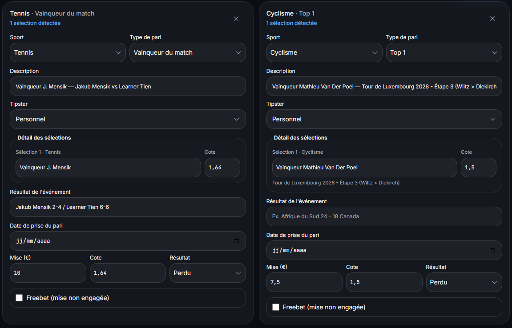

# Comment comparer ses résultats de paris par sport sans tirer de conclusion trop vite ?

> Brouillon préparé le 2 novembre 2026 — non publié. Ciblage à qualifier ; aucune date de publication définie.

Pour comparer vos résultats par sport, conservez une période et des règles de calcul communes, puis regardez ensemble le nombre de tickets réglés, les mises engagées et le bénéfice net. Une perte plus faible en euros ne suffit pas à dire qu’un sport vous réussit davantage : vous pouvez simplement y avoir misé moins.

## Commencez par une question précise

Un tableau par sport peut répondre à plusieurs questions : où avez-vous engagé le plus d’argent, sur quel groupe avez-vous perdu le plus en euros, ou quel résultat avez-vous obtenu par rapport aux mises ? Ces questions utilisent les mêmes tickets, mais elles ne donnent pas le même classement.

Définissez ce que vous voulez lire avant de trier les lignes. Un classement des pertes brutes décrit les montants perdus. Il ne mesure pas, à lui seul, une différence de compétence entre le tennis, le football ou le cyclisme.

## Comparez des groupes construits de la même manière

Choisissez une période commune et gardez le même périmètre : bankroll, bookmaker éventuel, devise, type de pari et état de règlement. Comptez les tickets effectivement réglés pour cet exemple ; les paris en attente n’ont pas encore de résultat définitif.

Traitez séparément les freebets, remboursements et cash outs tant que leur convention n’est pas explicitée. Les mises et les retours doivent représenter la même chose dans chacun des groupes comparés.

Vérifiez aussi la règle de classement des combinés. Un ticket contenant plusieurs sports porte une mise commune : recopier cette mise entière dans chaque sport gonflerait les totaux. Conservez une catégorie dédiée ou une autre convention clairement documentée, puis vérifiez que les sous-totaux se rapprochent du total de votre historique.

## Un exemple réel : un ticket de tennis et un ticket de cyclisme

Les captures fournies par Jeremy le 25 septembre 2026 documentent deux paris simples du 18 septembre. Le ticket de tennis porte une mise de 10 €. Le ticket de cyclisme porte une mise de 7,50 €. Tous deux sont perdus, avec un retour nul ; les lignes d’historique correspondantes affichent −10 € et −7,50 €.

Le tableau ci-dessous porte uniquement sur ces deux tickets. Il ne représente ni la bankroll complète de Jeremy ni ses résultats habituels sur ces sports.

| Indicateur | Tennis | Cyclisme | Total de l’extrait |
| --- | --- | --- | --- |
| Tickets réglés | 1 | 1 | 2 |
| Mises engagées | 10,00 € | 7,50 € | 17,50 € |
| Retours reçus | 0,00 € | 0,00 € | 0,00 € |
| Bénéfice net | −10,00 € | −7,50 € | −17,50 € |
| Résultat rapporté aux mises | −100 % | −100 % | −100 % |

## Pourquoi le cyclisme ne ressort pas « meilleur » dans cet exemple

Le cyclisme a perdu 2,50 € de moins en valeur absolue. La mise y était aussi inférieure de 2,50 €. Dans chaque groupe, le retour est nul et toute la mise est perdue : le résultat rapporté aux mises est donc identique.

Dire « j’ai perdu moins en cyclisme » décrit correctement cet extrait. En déduire « je suis plus performant en cyclisme » ajoute une conclusion que ces données n’établissent pas. Chaque groupe ne contient ici qu’un seul ticket.

Le calcul confirme cette distinction : −10 ÷ 10 = −1 pour le tennis, et −7,50 ÷ 7,50 = −1 pour le cyclisme, soit −100 % dans les deux cas. L’article sur le ROI détaille la formule et sa différence avec le taux de réussite.

## Gardez le nombre de tickets et les mises visibles

Affichez le nombre de tickets à côté du pourcentage. Sans cette information, deux groupes peuvent sembler comparables alors qu’ils reposent sur des historiques très différents.

Ajoutez les mises totales et, si cela aide la lecture, la mise moyenne. Celle-ci décrit l’argent engagé en moyenne par ticket ; elle n’explique pas à elle seule les résultats et ne constitue pas une recommandation de mise.

Un résultat observé sur un groupe reste un résultat passé. Il n’existe pas, dans cet exemple, de seuil de tickets qui permettrait de déclarer un sport définitivement meilleur. Aucune estimation de probabilité future n’est calculée à partir de ces deux paris.

## Faites les mêmes vérifications à chaque bilan

Conservez la période, les filtres et la convention de classement avec votre relevé. Lors d’une comparaison ultérieure, commencez par vérifier que ces éléments n’ont pas changé.

Si un résultat a été corrigé, notez la correction avant de comparer les chiffres. Si une ligne manque ou apparaît deux fois, corrigez l’historique avant d’interpréter le tableau. Le détail des tickets sert à retrouver l’origine des montants.

Dans Kalivoa, les informations proposées à partir d’un scan doivent être relues avant l’enregistrement. L’import par capture ne demande aucun accès au compte bookmaker. L’image associée à cet article montre la relecture de ces deux tickets ; elle ne présente pas un nouveau test de l’écran de statistiques.

## Utilisez le bilan pour comprendre votre historique

Pour cet extrait, la conclusion se limite à ceci : deux tickets réglés, 17,50 € engagés, aucun retour et une perte nette de 17,50 €. La répartition par sport explique où ces montants se trouvent.

Ce bilan ne justifie pas d’augmenter les mises sur un sport, de chercher à récupérer une perte ou de prévoir le prochain résultat. Pour poursuivre la lecture, distinguez le résultat final du parcours suivi : le drawdown décrit les baisses intermédiaires d’une courbe.

## Preuve et source

Capture de relecture déjà publiée dans l’Académie : un pari de tennis de 10 € et un pari de cyclisme de 7,50 €, tous deux marqués perdus. Les dates sont encore vides dans cet écran de relecture ; la datation du 18 septembre vient des tickets originaux et de l’historique documentés.

Source de l’exemple : tickets originaux et historique Kalivoa fournis par Jeremy le 25 septembre 2026, portant sur deux paris simples du 18 septembre. Les montants sont ceux de cet extrait, pas ceux de la bankroll complète. Le rapprochement par sport a été calculé à partir de ces données ; aucun test nouveau de filtre produit n’est revendiqué.

## Pour poursuivre

- [Calculer le ROI et le distinguer du taux de réussite](https://kalivoa.com/fr/academie/calculer-roi-paris)
- [Suivre un combiné sans compter plusieurs fois sa mise](https://kalivoa.com/fr/academie/suivre-pari-combine)
- [Comprendre le drawdown de sa bankroll](https://kalivoa.com/fr/academie/comprendre-drawdown-bankroll)
- [Comprendre le suivi de bankroll](https://kalivoa.com/fr/bankroll-tracking)

