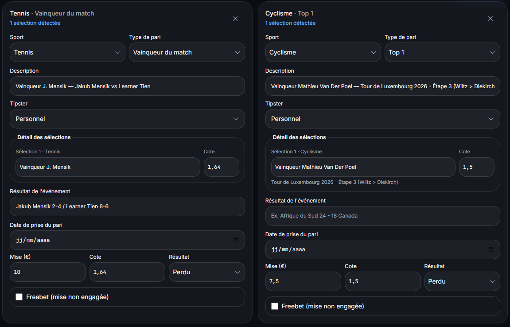

# Brouillon d'enrichissement FR — suivi de bankroll

**Destination :** page existante `/fr/bankroll-tracking`, jamais une nouvelle URL pour la même intention. **Statut :** brouillon interne du 30/09/2026, non publié. Le lien « Académie » ajouté au pied de page le 07/10 relance par prudence l'observation de cette page marketing jusqu'au 05/01/2027 environ, avant une livraison éditoriale unique. Avant intégration, relire le sitemap et les requêtes GSC de cette URL. Son title actuel, « Suivi de bankroll pour les paris sportifs », et son H1 actuel, « Une bankroll lisible, même quand votre historique grandit », restent inchangés tant que leurs requêtes et risques de perte ne sont pas examinés.

**Intention :** répondre simplement à « comment suivre sa bankroll de paris sportifs ? » en distinguant capital, mouvements d'argent, mises et résultats. Volume de la requête exacte et difficulté : **à vérifier auprès de Jeremy**. Ne pas promettre de position ni de gain.

**Preuve vécue :** [capture réelle de relecture](assets/relecture-ticket-pari-kalivoa.png) fournie par Jeremy le 25/09 et validée pour un extrait anonymisé avant publication. Elle montre deux paris détectés et les champs que l'utilisateur doit vérifier, dont une date encore vide. Cette capture prouve l'étape de relecture, pas l'exactitude globale de l'OCR ni la performance de la bankroll. La placer près de la section sur l'enregistrement des paris ; éviter de la présenter comme une capture du tableau de bord.

**Maillage prévu :** `/fr/screenshot-import` pour le détail du scan, `/fr/faq` pour les limites et corrections, `/fr/responsible-gambling` pour le jeu responsable. Garder le CTA existant. Aucun nouveau balisage FAQPage à ajouter sans FAQ visible ; les données structurées de base existent déjà sur le site.

---

## Texte proposé pour une livraison unique après observation

### Qu'est-ce que le suivi de bankroll ?

Suivre une bankroll consiste à enregistrer le capital consacré aux paris, ses dépôts et retraits, puis chaque mise et chaque résultat. Ce suivi permet de retrouver ce qui vient d'un mouvement d'argent et ce qui vient réellement des paris. Il décrit une activité passée ; il ne prédit pas les paris à venir.

### Une méthode simple en cinq étapes

1. **Définissez votre capital de départ.** Choisissez la somme que vous souhaitez suivre et la bankroll concernée. Si vous séparez plusieurs bookmakers ou usages, donnez à chaque bankroll un nom distinct.
2. **Enregistrez les dépôts et retraits à part.** Un dépôt augmente le solde disponible, mais ce n'est pas un bénéfice de pari. Un retrait diminue le solde, mais ce n'est pas une perte de pari.
3. **Ajoutez chaque pari une seule fois.** Notez l'événement, la sélection, la date, la mise et la cote. Pour un combiné, conservez les sélections qui le composent. Une saisie manuelle reste possible.
4. **Relisez les captures avant d'enregistrer.** Si vous importez un ticket avec Kalivoa, comparez la proposition de lecture au ticket original. Corrigez notamment la sélection, la cote, la mise, la bankroll, le résultat et une date manquante. Aucun accès au compte bookmaker n'est demandé pour cet import.
5. **Mettez le résultat à jour et lisez les indicateurs dans leur contexte.** Comparez l'historique, le profit et le ROI sur une période définie. Un indicateur calculé sur quelques paris varie fortement et ne démontre pas une méthode gagnante.

### Une étape de contrôle visible dans Kalivoa

Sur cette capture réelle, Kalivoa propose la relecture d'un pari de tennis et d'un pari de cyclisme. On y voit la sélection, la cote, la mise et le résultat proposés. La date n'est pas remplie : il faut la vérifier avant de valider. La lecture de la capture facilite la saisie, mais le contrôle de l'utilisateur reste indispensable.

*Capture fournie par Jeremy le 25/09/2026. Extrait réel de la relecture, sans référence de ticket ni donnée personnelle visible. Elle ne constitue pas une mesure de précision de l'OCR.*

### Quatre erreurs qui faussent la lecture de la bankroll

- **Compter un dépôt comme un gain.** Gardez les mouvements de capital séparés du profit des paris.
- **Oublier des paris perdus ou doubler un ticket.** L'historique doit inclure chaque pari une seule fois, quel que soit son résultat.
- **Valider une lecture automatique sans contrôle.** Une cote, une mise ou un statut mal lu peut changer les statistiques affichées.
- **Interpréter un petit échantillon comme une tendance.** Le profit ou le ROI de quelques paris décrivent ces paris, sans prédire les suivants.

Pour voir [comment l'import par capture fonctionne](https://kalivoa.com/fr/screenshot-import), consultez la page dédiée. Les [questions fréquentes](https://kalivoa.com/fr/faq) expliquent les corrections possibles. Si le suivi vous incite à miser davantage ou devient difficile à contrôler, consultez les ressources de [jeu responsable](https://kalivoa.com/fr/responsible-gambling).

## Contrôles avant intégration

- Vérifier que le parcours, les termes « capital de départ », dépôts/retraits, ROI et freebets reflètent toujours le produit au moment de la livraison ; vérifier les cas de mise gratuite dans le calcul.
- Contrôler les requêtes de `/fr/bankroll-tracking` dans GSC avant toute modification de title ou H1 ; préserver ces éléments si le risque de perte n'est pas évaluable.
- Vérifier une dernière fois l'accord et l'anonymisation de la capture retenue, puis intégrer le texte, le visuel et les liens en **une seule** livraison sur cette page.
- Inscrire la date du déploiement et la nouvelle fin d'observation de 90 jours dans le suivi.

## Complément éditorial préparé le 8 octobre 2026

Ce complément appartient au brouillon interne. Il sera regroupé avec le texte ci-dessus en une seule livraison, après observation et contrôle des requêtes. Aucun ajout public n'est effectué aujourd'hui.

### Quel indicateur lire après avoir enregistré ses paris ?

Le bénéfice net décrit ce que les paris du périmètre ont rapporté ou perdu. Le ROI rapporte ce résultat aux mises engagées selon la convention de l'indicateur. Le taux de réussite compte les résultats gagnés. Le drawdown décrit une baisse depuis un précédent sommet de la courbe. Une même période peut être bénéficiaire et comporter un recul important.

Choisissez les mêmes filtres et la même période avant de comparer les chiffres. Regardez le nombre de paris réglés, les mises réellement engagées et les résultats. Les paris en attente, freebets, remboursements et cash outs demandent une convention claire ; ils ne doivent pas être mélangés à un exemple de simples cash sans explication.

### Un relevé réel que l'on peut contrôler

Les deux paris simples présentés dans les captures fournies le 25 septembre 2026 ont des mises de 10 € et 7,50 €, avec un retour nul et un résultat perdu. Dans l'historique, les pertes sont de 10 € et 7,50 €. Ce sous-ensemble engage donc 17,50 € et perd 17,50 €. Il illustre une vérification d'historique, pas le bilan complet de la bankroll.

Le [calcul détaillé du ROI](https://kalivoa.com/fr/academie/calculer-roi-paris) conserve explicitement ce périmètre. Les autres tickets ne sont pas inclus dans cet exemple.

### Pour approfondir chaque étape

| Besoin | Lecture associée |
|---|---|
| Contrôler les informations détectées | [Vérifier les champs d'un ticket après un scan](https://kalivoa.com/fr/academie/verifier-ticket-pari-scan) |
| Enregistrer plusieurs sélections avec une seule mise | [Suivre un pari combiné](https://kalivoa.com/fr/academie/suivre-pari-combine) |
| Comprendre un pourcentage de performance | [Calculer le ROI et le distinguer du taux de réussite](https://kalivoa.com/fr/academie/calculer-roi-paris) |
| Lire une baisse de la courbe | [Comprendre le drawdown en unités](https://kalivoa.com/fr/academie/comprendre-drawdown-bankroll) |
| Interpréter les montants publics | [Comprendre les mises en unités](https://kalivoa.com/fr/academie/comprendre-unites-bankroll) |
| Contrôler les preuves d'un historique public | [Vérifier les paris d'un tipster](https://kalivoa.com/fr/academie/verifier-paris-tipster) |

### Consignes d'intégration de ce complément

Conserver le title et le H1 actuels tant que leurs requêtes et le risque de perte ne sont pas examinés. Remplacer le brouillon par une version finale cohérente, sans empiler des paragraphes qui répètent les pages produit. Garder sur le pilier la méthode générale ; laisser les calculs détaillés dans l'Académie. Réutiliser seulement la capture déjà validée et les chiffres concordants des deux simples. Livrer texte, preuve et maillage ensemble, puis consigner les 90 jours d'observation.
