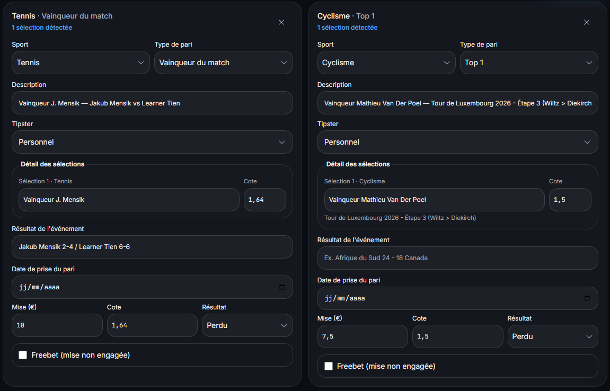

# Guide FR prêt à intégrer — Quels champs vérifier après le scan d’un ticket de pari ?

**Statut :** texte et preuve préparés le 25/09/2026, non publiés. Les pages `/fr/screenshot-import`, `/fr/bankroll-tracking` et `/fr/faq` ont été modifiées le 23/09/2026 ; ne pas les retoucher pendant leur fenêtre d’observation. Avant de créer une URL distincte, vérifier de nouveau le sitemap, les requêtes GSC et l’intention de recherche, puis prévoir un vrai lien interne vers elle. Si l’intention est déjà couverte, intégrer ce guide à la page existante après sa fenêtre d’observation.

**Vérification préalable au 25/09 :** les 26 URL du sitemap ne comprennent aucun guide dédié à la vérification des champs après lecture OCR. Dans GSC, aucune ligne de requête contenant « ticket » n’est visible sur la période 23/06–22/09/2026 ; les requêtes sont largement anonymisées. Le volume et la difficulté de cette question restent **à vérifier auprès de Jeremy**. La FAQ répond déjà à « Puis-je corriger les informations extraites ? » et la page d’import décrit le parcours général ; il faut contrôler le risque de doublon avant publication.

**Title proposé :** Vérifier un ticket de pari scanné avant de l’enregistrer | Kalivoa  
**Meta description proposée :** Quels champs contrôler après la lecture d’une capture de ticket ? Une checklist concrète pour vérifier sélection, cote, mise et résultat avant l’enregistrement.  
**URL envisagée, seulement si intention distincte confirmée :** `/fr/guides/verifier-ticket-pari-scan`  
**Balisage à l’intégration :** Article et BreadcrumbList, avec date de publication réelle, auteur Kalivoa et image de preuve. Ne pas ajouter de FAQPage si aucune FAQ n’est visible dans la page.

---

# Quels champs vérifier après le scan d’un ticket de pari ?

Avant d’enregistrer un pari lu sur une capture d’écran, comparez chaque ligne proposée avec le ticket d’origine. Vérifiez au minimum **la sélection, la cote, la mise et le résultat** ; contrôlez aussi la date, le type de pari, la bankroll et le statut « freebet » lorsqu’ils s’appliquent. Corrigez toute information manquante ou mal lue avant de valider. Une lecture OCR facilite la saisie, mais ne remplace pas ce contrôle.

## Pourquoi relire les données détectées ?

Une erreur de mise ou de résultat se retrouve ensuite dans le profit et les statistiques. Une cote incorrecte change le calcul d’un pari gagné. Une mauvaise sélection rend l’historique difficile à vérifier. Le contrôle est particulièrement utile lorsque la capture est petite, floue, coupée ou contient plusieurs tickets.

Kalivoa présente les paris détectés dans un écran de relecture obligatoire. L’utilisateur peut corriger les champs avant l’enregistrement. L’import part des captures choisies ; **aucun accès au compte bookmaker n’est demandé**.

## La checklist avant de valider

1. **Comptez les paris.** Comparez le nombre de paris proposés avec les tickets visibles sur la capture. Pour un combiné, vérifiez aussi chaque sélection qui le compose. Ne créez pas deux fois le même pari si plusieurs images montrent le même ticket.
2. **Comparez l’événement et la sélection.** Vérifiez le sport, le marché, les participants et le choix réellement parié. Deux marchés sur le même match ne sont pas interchangeables.
3. **Contrôlez la cote et la mise.** Lisez les chiffres sur le ticket d’origine, y compris les virgules décimales. Une cote et une mise exactes sont nécessaires pour interpréter ensuite le résultat financier.
4. **Vérifiez la date et le statut.** Renseignez les champs manquants. Pour un ticket déjà réglé, comparez « gagné », « perdu », « remboursé » ou « cash out » avec ce que montre le ticket. Si l’information n’est pas lisible, ne la déduisez pas de mémoire.
5. **Vérifiez la bankroll et le freebet.** Associez le pari à la bonne bankroll. Une mise gratuite ne représente pas la même somme engagée qu’une mise en argent réel.
6. **Relisez une dernière fois, puis enregistrez.** Ouvrez l’historique pour confirmer que le pari apparaît une seule fois, avec les champs corrigés.

## Un exemple réel de relecture

La capture ci-dessous provient d’un parcours réel dans Kalivoa. Deux paris simples y sont proposés à la vérification, l’un en tennis et l’autre en cyclisme. L’écran montre notamment la sélection, la cote, la mise et le résultat. Les champs de date sont encore vides sur cette image : c’est précisément le type de point à vérifier avant l’enregistrement.

*Capture fournie par Jeremy le 25/09/2026. Elle montre l’étape de relecture ; elle ne mesure ni la rapidité ni la précision globale de l’OCR. Aucun identifiant ni référence de ticket n’est visible.*

## Et si le ticket est mal lu ?

Corrigez les champs proposés avant de sauvegarder. Si une sélection ou un statut reste incertain, revenez au ticket d’origine. Si la capture ne permet pas de trancher, une saisie manuelle est préférable à une valeur supposée. Consultez le [fonctionnement de l’import par capture](https://kalivoa.com/fr/screenshot-import) et les [réponses aux questions fréquentes](https://kalivoa.com/fr/faq) pour connaître les limites actuelles.

Un historique fiable vient de paris correctement enregistrés, pas d’une promesse de résultat. La page [suivi de bankroll](https://kalivoa.com/fr/bankroll-tracking) explique comment distinguer les paris des mouvements de capital. Si le suivi devient une incitation à miser davantage, consultez les ressources de [jeu responsable](https://kalivoa.com/fr/responsible-gambling).
